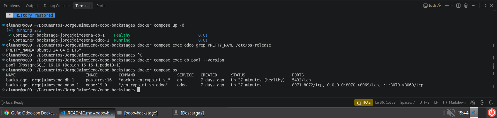

# BackStage Rent · Módulo de alquileres para Odoo

**Alumno/a:** *Jorge Jaime Sena* · SGE · 2.º DAM · IES El Majuelo

## Apartado 0 · Mi instalación de Odoo

> Sustituye todo lo que está en *cursiva* y borra las líneas que empiezan por `>`. Escribe con tus palabras.

### 1. Mi equipo, el sistema operativo y la base de datos

| | |
|---|---|
| Sistema operativo de mi equipo | *Ubuntu del aula* |
| Sistema operativo dentro del contenedor de Odoo | *Ubuntu 24.04.5 LTS* |
| Gestor de base de datos y versión | *psql (PostgreSQL) 16.16 (Debian 16.16-1.pgdg13+1)* |
| Versión de Odoo y puerto | *odoo:19.0 8070* |

*Utilizamos Docker para que el programa vaya ligado con las dependencias y así no tener problemas al utilizar diferentes dispositivos*

### 2. Arquitectura

> Completa el esquema con los datos de tu `docker-compose.yml`.

```text
Navegador ──puerto 8069──▶ contenedor odoo ──▶ contenedor db
                                   │                  │
                    volumen Odoo_web_data y addons  volumen odoo_db_data
```

*El cliente muestra la interfaz y se comunica con el servidor por el puerto 8079.
 El servidor de Odoo se comunica con los datos, accede a los addons y al volumen de web_data. 
 La capa de datos se conecta con el servidor por el puerto 5432 y se comunica con la base de datos.*

### 3. Comprobación y copia de seguridad



*Docker compose ps enseña los contenedores que se están ejecutando, en este caso aparecen el de Odoo y el de la base de datos, como debería ser.*

*Copia de seguridad: backstage_2026-11-25_14-48-35.zip y tamaño del zip: 2.0Mb.  Lo guardo en /home/alumno/Escritorio/Jorge Jaime Sena/SGE/backup db backstage*

### 4. Licencia

*Odoo Comunity es gratuita y de código abierto. Odoo enterprise es de pago, pero viene con más funcionalidades. Por ejemplo, Enterprise viene con varias funcionalidades de contabilidad integradas.
La licencia que tenemos en el manifest es LGPL-3, por lo que podemos utilizar, modificar el código y hasta distribuirlo si quisiéramos.*

### 5. Incidencias

| Issue | Problema | Causa | Solución |
|---|---|---|---|
| *[#1](enlace a la issue)* | | | |
